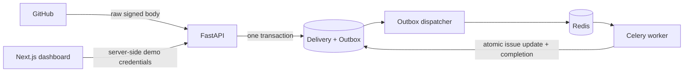

# RepoPilot

A modular monolith for GitHub issue ingestion, commit-pinned source retrieval and durable
investigations. Sprint 4 checkpoint 4D produces evidence-grounded reports with a deterministic
mock provider. Real AI inference and GitHub write operations are not enabled.

**Status: Sprint 3 C3 and Sprint 4 checkpoints 4A–4D were verified locally**, including
authorized GitHub reads and local PostgreSQL/Redis/Celery workflows. These checks do not
establish production readiness or real-model diagnostic quality. See [verification results](docs/verification.md).

**Sprint 1 historical status: verified locally.** The host-reported signed webhook
smoke test passed through PostgreSQL, Redis/Celery, the authorized API, and the dashboard data
route; a screenshot showed processed issues in the browser. The PostgreSQL-backed test suite
passed all 39 tests without warnings, and the clean frontend install, type check, lint, tests,
and build passed. Nine frontend tests now include server-rendered loading, error, unauthorized,
empty, and issue-list states; browser fetch transitions and a real GitHub Actions run remain open.
The dependency lockfiles are tracked. See [verification results](docs/verification.md).

## Quick start

Requirements: Docker Engine/Desktop with Compose v2 supporting `up --wait`, Python 3.12+
(or a recent Python for the small environment helper), Node.js 22 for host frontend checks,
and `uv` 0.13.6 for dependency locking (matching CI and the API image). Internet access is needed for first-time image/dependency downloads.

From this directory:

```bash
# Creates a private, ignored .env with random development-only credentials.
# Refuses to overwrite an existing file. Alternatively copy and edit .env.example.
test -f .env || python3 infra/init_env.py

make dev
make migrate
make seed
make smoke
```

Open **http://localhost:3000**. API docs are at **http://localhost:8000/docs**.
`make seed` creates only the clearly marked demo identity, installation, and repository.
`make smoke` submits a signed demo issue and waits for the real worker to process it.
Both `make seed` and `make smoke` require `APP_ENV=development` and
`DEMO_AUTH_ENABLED=true` on the running stack; they intentionally fail when the demo is
disabled for real GitHub sign-in. For smoke testing without changing that stack, use a
separate Compose project and database. The successful host procedure and its limitations are
recorded in `docs/verification.md`.
The dashboard refreshes every five seconds in demo mode and every thirty seconds for real
accounts. Seed is repeatable and does not re-enable revoked access.
The smoke test checks unauthenticated reads, invalid signatures, duplicate deliveries, database
issue uniqueness, and the dashboard data route; it does not inspect a rendered browser UI.
A fresh `.env` was generated locally during implementation; do not overwrite it or commit it.

`make dev` builds images, starts PostgreSQL 16 with pgvector, Redis, API, worker, outbox
dispatcher, and web, and waits for health checks. A one-shot migration service runs first.
`make migrate` is useful when adding migrations later. API/web bind to loopback only;
PostgreSQL/Redis do not expose host ports. `make down` preserves database volumes.

```bash
make test                         # Pytest in the API container (SQLite unit/service suite)
cd apps/web && npm ci && npm test && cd ../..
make lint                         # Ruff, frontend type checking, ESLint
make smoke                        # Actual HTTP/database/broker/worker/web-data integration
```

Docker and CI use `uv sync --locked` and `npm ci`; both lockfiles were included in the
previous Git commit. Run `make lock` only when intentionally updating dependency resolution.

## Review and version control

Review the working tree and stage only intended files before committing:

```bash
git status --short
git diff
git diff --cached --stat
git diff --cached --check
```

Never include `.env`, credentials, private keys, database dumps or unrelated work in a commit.

## Project layout

```text
apps/
  api/
    app/
      api/v1/routes.py          # HTTP validation and tenant-scoped reads
      core/config.py           # Environment validation; production demo prohibition
      domain/models.py         # SQLAlchemy entities and constraints
      modules/
        github/                # Webhook schemas, signature verification, client protocol
        tenancy/               # Development identity and membership check
        ingestion/             # Transactional acceptance and lifecycle revocation
      infra/database.py
      workers/                 # Durable dispatcher and Celery task
      main.py, seed.py, smoke.py
    alembic/versions/0001_foundation.py
    tests/                     # Security, service, retry, isolation, concurrency
    Dockerfile, pyproject.toml
  web/
    app/                       # Next.js App Router and same-origin server routes
    components/                # Inbox dashboard and reusable status badge
    lib/                       # Shared types and server-only API client
    Dockerfile, package.json
docs/
  reference/                   # Preserved architecture proposals; not executable migrations
  adr/0001-foundation.md
  verification.md
infra/init_env.py
.github/workflows/ci.yml
compose.yaml, Makefile, AGENTS.md
```

The original `RepoPilot/` reference bundle and archive remain untouched. The current workspace
is a Git checkout; see the verification record for the status of testing and commits.

## How ingestion works



1. Stream at most 1 MiB; verify HMAC-SHA256 against the original bytes using constant-time
   comparison, following [GitHub's verification guidance](https://docs.github.com/en/webhooks/using-webhooks/validating-webhook-deliveries).
2. Require JSON, a UUID delivery ID, supported event/action, and a valid bounded payload.
3. Check explicit installation/repository authorization. Write the delivery hash and minimal
   normalized outbox payload in one transaction. Never trust a tenant ID from a webhook.
4. Return `202` after commit without contacting GitHub or the broker. Identical redelivery
   returns `200`; reuse of an ID for different content returns `409`.
5. A separate dispatcher polls PostgreSQL using `FOR UPDATE SKIP LOCKED`, publishes the
   stable event ID to Celery, and schedules a retry. The row stays pending until processing
   commits; broker loss after publishing can therefore be repaired by republication.
6. The worker locks the event, installation, and repository, rechecks authorization, updates
   the issue only for a strictly newer GitHub timestamp, and marks completion atomically.

Delivery is **at least once**, with idempotent database effects, not exactly once. A crash
between publish and commit can produce another message. Stable Celery IDs alone do not
deduplicate work; database locks, constraints, and completion state do.

Celery retries transient database failures with bounded exponential backoff and jitter;
see [Celery task semantics](https://docs.celeryq.dev/en/stable/userguide/tasks.html).
The dispatcher makes up to 20 attempts with delays capped at five minutes. After exhaustion,
the event is `failed` and appears in dashboard counts. Inspect service/database health before
an operator resets a failed event to `pending`, `attempts=0`, and `next_dispatch_at=now()`.
Never change the stored payload during replay. Workers still recheck authorization.

Repository locking serializes issue updates within one repository, which is deliberately
simple for Sprint 1. Equal source timestamps keep the first applied state because GitHub
provides no reliable tie-breaker here. A later reconciliation job should resolve this ambiguity.

## API and identity

| Endpoint | Access and behavior |
| --- | --- |
| `GET /health` | Liveness only |
| `GET /ready` | Database schema and Redis reachable; not a worker heartbeat |
| `POST /v1/webhooks/github` | HMAC-authenticated; issues opened/edited and supported installation lifecycle |
| `GET /v1/repositories` | Real session with fresh GitHub repository-access verification, or non-production demo token; max 100 |
| `GET /v1/repositories/{id}/issues?offset=0` | Same tenant and active-installation check; pages of 100, ingestion counts |
| `GET /v1/auth/github/start`, `GET /v1/auth/github/callback` | GitHub App user authorization, browser-bound state and PKCE |
| `GET /v1/auth/me`, `POST /v1/auth/logout` | Session identity; logout requires same-origin CSRF token |
| `GET /v1/installations/available` | GitHub-verified personal-account installations for the signed-in user |
| `POST /v1/installations/{id}/enroll` | CSRF-protected verification and personal-tenant binding |
| `POST /v1/installations/{id}/repositories/{repo}/select` | CSRF-protected public repo selection and durable initial-sync job |
| `GET /v1/installations/sync/{id}` | Tenant- and GitHub-authorized sync status |

Demo authentication requires both a non-production environment and `DEMO_AUTH_ENABLED=true`.
Production rejects this configuration on startup. With demo disabled, data APIs require a valid
GitHub-authenticated session. The demo tenant/user IDs are server configuration,
never client-selected. Unknown and other-tenant repositories both return `404`.

Next.js holds `DEMO_API_TOKEN` server-side. Its shared demo data route is enabled only when
`APP_ENV=development` and the demo switch is true. There is no `NEXT_PUBLIC_` secret.
Anyone who can reach this development dashboard shares its demo identity; keep it on loopback.
Issue titles are rendered as React text, never HTML. No fake issue rows are embedded in the UI.

## Environment

| Variable | Purpose |
| --- | --- |
| `APP_ENV` | `development`, `test`, or `production`; backend default is production |
| `POSTGRES_USER`, `POSTGRES_DB`, `POSTGRES_PASSWORD` | Compose database settings; use generated URL-safe hex password |
| `DATABASE_URL` | SQLAlchemy `postgresql+psycopg://...`; Compose constructs it; required for host API/Alembic |
| `REDIS_URL` | Celery broker/readiness URL; Compose uses `redis://redis:6379/0` |
| `GITHUB_WEBHOOK_SECRET` | At least 32 characters; shared with GitHub App webhook settings |
| `DEMO_AUTH_ENABLED` | Explicit development/test-only backend identity bypass; defaults false |
| `DEMO_API_TOKEN` | At least 32 characters when demo enabled; server-side only |
| `DEMO_USER_ID`, `DEMO_TENANT_ID` | Demo user and tenant membership IDs; default 1 |
| `API_INTERNAL_URL` | Next.js server-to-API URL; Compose uses `http://api:8000` |
| `TEST_DATABASE_URL` | Disposable PostgreSQL database for concurrency tests; test suite drops its tables |
| `SMOKE_API_URL`, `SMOKE_WEB_URL` | Optional smoke overrides; defaults to Compose service names |
| `GITHUB_OAUTH_ENABLED` | Explicit opt-in for real GitHub sign-in; defaults false |
| `GITHUB_APP_ID`, `GITHUB_CLIENT_ID`, `GITHUB_CLIENT_SECRET` | GitHub App ID and OAuth client credentials |
| `GITHUB_TOKEN_ENCRYPTION_KEY` | Fernet key used to encrypt GitHub tokens and one-time PKCE verifiers |
| `GITHUB_CALLBACK_URL`, `WEB_ORIGIN` | Fixed browser origin and `/api/auth/callback`; HTTPS is required in production |

Never log `.env`, Authorization headers, tokens, or webhook bodies. Application logs use fixed
JSON event names; SQLAlchemy hides parameters from errors. PostgreSQL holds issue descriptions
and normalized outbox data, so database access and backups also need protection.

## GitHub App setup (Sprint 2A)

The integration was verified locally with an authorized public repository; it has not been
verified for production deployment. No credentials are required for the Sprint 1 demo.

Sprint 3's experimental indexing backend requires GitHub App repository **Contents: read-only**
permission. Changing permissions on an existing installation currently revokes its RepoPilot
enrollment and there is no reauthorization flow; use a separate development installation for
testing. GitHub indexing and PostgreSQL search have been exercised locally.

`POST /v1/repositories/{id}/index` queues a durable job, `GET .../index-status` returns the
latest job and published snapshot, and `POST .../search` accepts `{"query":"...","limit":10}`.
Both POSTs require the session CSRF token and same-origin header. The worker rechecks GitHub
access, pins a commit, collects Python source, and publishes the snapshot transactionally.
PostgreSQL keyword search returns commit-pinned GitHub line links. Access remains subject to
the signed-in user's session, repository authorization and the published-snapshot restriction.

Default limits are 10,000 tree entries, 1,000 Python files, 100,000 bytes per file,
5,000,000 total bytes, 10,000 chunks, 1,005 source requests and 120 seconds for source
retrieval; the worker has a 200-second hard limit. Oversize or detected-secret files are
excluded and the snapshot is marked partial. A truncated tree is rejected. The pattern
filter catches only some recognizable credentials and cannot guarantee that source is safe.
Repository content is untrusted. Workers claim a fenced 240-second lease before network work,
fetch outside database transactions, then check the lease, session, installation, repository
and default-branch commit before atomic publication. An expired claim can be republished.
The final authorization check and GitHub request are not a single distributed transaction;
webhook delivery latency and provider-side changes remain operational risks. Historical
snapshots are retained; retention, detailed progress and production operational controls remain
unfinished. Migration `0003` adds jobs, snapshots, files, chunks and PostgreSQL FTS indexes.
Indexing emits JSON lifecycle events with job, repository, task and snapshot identifiers where
available. Events do not include credentials, raw source or exception bodies. Historical jobs
cannot be retroactively given task logs, and logs are not a substitute for persisted job status.

### Experimental embeddings (Sprint 3 B1)

Embedding storage and exact pgvector search are under active development. The default
`EMBEDDING_PROVIDER=disabled` leaves keyword search in place. `EMBEDDING_PROVIDER=fake` is
restricted to development/test and creates deterministic vectors solely for testing the
pipeline; their retrieval quality is not a semantic benchmark. The API exposes
`POST /v1/repositories/{id}/embeddings` and `GET /v1/repositories/{id}/embedding-status`;
both require the existing authenticated repository access and POST requires CSRF. A published
snapshot is required. Search accepts `mode` (`keyword`, `semantic`, `hybrid`); when compatible
embeddings are unavailable, the response reports keyword fallback. Readiness is specific to
the current snapshot and configured model. Citations use the backend's commit-pinned URLs.
Migrations `0005` and `0006` require PostgreSQL with pgvector;
do not run test fixtures against the application database. Back up the application database and
obtain explicit approval before migrating it; Compose's migration service runs `alembic upgrade
head` automatically on startup. Downgrading these migrations drops embedding jobs and vectors.

An OpenAI adapter is implemented against the [embeddings API](https://developers.openai.com/api/reference/resources/embeddings/methods/create),
but paid background generation is deliberately disabled until separately approved and budgeted.
No paid call has been made. Source pattern filtering cannot guarantee secrets are absent;
review what data would leave the server before enabling any external provider. Vector and hybrid
search have been verified locally on the existing repository using only deterministic fake
vectors, PostgreSQL, Redis and Celery; fake vectors do not demonstrate semantic quality. See
`docs/verification.md` for the actual counts, tests and remaining limitations.

### Retrieval evaluation (Sprint 3 C1)

The 20-question, commit-pinned benchmark, chunk eligibility audit, authenticated evaluation
command, metric definitions and an unapproved paid experiment plan are in
`apps/api/evaluation/`. The harness calls the existing authorized same-origin search API and
writes Markdown and JSON without source snippets or credentials. The first authenticated run
fell back for semantic and hybrid requests; a second ran all three modes with fake vectors.
Fake semantic/hybrid metrics are mechanical checks, not evidence of semantic quality. The pinned
commit predates the indexing and embedding modules,
so those newer features cannot be labeled against it.

The C2 lexical strategy uses English stemming and stop-word removal, underscore splitting, OR
matching, and an exact-symbol boost. The unchanged pinned-snapshot benchmark and per-query
before/after API results are in `apps/api/evaluation/c2-comparison.md`. English search expressions
are not covered by the existing simple-language FTS indexes and are subject to the existing
three-second query timeout; production-scale performance remains unverified.

The C3 generated-corpus PostgreSQL experiment, including query plans, latencies and index-size
tradeoffs, is documented in `apps/api/evaluation/c3-scale.md`. In that limited fixture, additional
English GIN indexes were not selected and did not consistently improve latency, so no index was added. The
original benchmark was rerun with unchanged labeled ranks; the comparison is in
`apps/api/evaluation/c3-comparison.md`. The separately versioned newer-module benchmark is
pinned to commit `956a4f9` and its disposable evaluation is reported in `v2-local.md`.

1. On a disposable, authorized personal test account, create a GitHub App with **Issues: read**
   and automatic **Metadata: read**; do not grant write permissions. Subscribe to issues and
   installation/installation-repositories lifecycle events. Install on selected **public** repos.
2. Configure an exact GitHub App user-authorization callback matching
   `http://localhost:3000/api/auth/callback` for local development, or an HTTPS origin with the
   same callback path in production. A public HTTPS webhook URL must route to
   `/v1/webhooks/github`; GitHub cannot reach localhost without an explicitly configured ingress.
3. In the ignored `.env`, set `GITHUB_OAUTH_ENABLED=true`, `GITHUB_APP_ID`, `GITHUB_CLIENT_ID`,
   `GITHUB_CLIENT_SECRET`, `GITHUB_CALLBACK_URL`, `WEB_ORIGIN`, and a fresh Fernet key in
   `GITHUB_TOKEN_ENCRYPTION_KEY`. Generate the key locally with Python's
   `cryptography.fernet.Fernet.generate_key()`; never paste secrets into logs, commits or chat.
   Keep `DEMO_AUTH_ENABLED=false` for real-user testing. Configure all five app processes through
   Compose; do not expose the Redis/PostgreSQL ports or demo UI publicly.
4. With the updated lockfile, run `make dev`, `make migrate` and `make smoke`; the migration
   service upgrades existing data.
   Back up and test on a disposable database before applying the migration to real data.
5. Choose **Sign in with GitHub**, authorize the App, and use **Find installations**. Only
   installations belonging to the signed-in user's personal account and public repositories
   accessible to the user token are eligible. Organization enrollment is not yet implemented.
   Explicitly verify an installation and connect a repository; this queues a durable bounded sync.
6. Removal, suspension and accepted permission changes fail closed; repository removal disables
   it. Tombstones prevent late enrollment/selection from undoing a prior removal. Re-enabling a
   revoked installation or repository is intentionally unavailable until reviewed reconciliation
   and reauthorization are implemented. GitHub additions and unsuspension never auto-enable access.

GitHub user access tokens remain encrypted on the server, not in browser JavaScript. Sessions
expire after at most one hour and require a fresh login; refresh tokens are not persisted. Initial
sync reads at most the first 100 GitHub issue/PR entries and explicitly reports `partial` when the
limit is reached. It does not claim complete history, pagination, or close/delete reconciliation.
A reverse proxy must redact authorization callback query strings, and the Docker API disables
Uvicorn access logging to avoid logging authorization codes. Add production rate limiting,
credential retention cleanup and independent security review before serving external users.

## Testing and CI

Backend tests cover signatures, malformed input, headers, size limits, unsupported actions,
deduplication, rollback, retry, worker idempotency, stale/equal timestamps, revocation, and
cross-tenant access. The signed HTTP-to-worker-to-read test uses an injected database factory.
CI configures PostgreSQL for the row-lock concurrency test and exercises migration upgrade,
metadata drift detection, downgrade, and upgrade. Never point `TEST_DATABASE_URL` at real data.

A separate Compose smoke job tests actual PostgreSQL/Redis/Celery and the Next.js data route.
The frontend job checks strict TypeScript, ESLint, mocked API-route tests, and a production build. These workflows
are authored but have not run on GitHub from this workspace.

For an offline signature-only check with Pytest available:

```bash
PYTHONPATH=apps/api python -m pytest --confcutdir=apps/api/tests/unit apps/api/tests/unit -q
```

For host development, install via `uv sync --locked` in `apps/api` and `npm ci` in `apps/web`,
provide reachable database/Redis URLs, run `uv run alembic upgrade head`, and start API,
dispatcher, Celery, and Next.js independently using the commands from Compose.

## Current limitations and next tasks

- GitHub Actions and browser fetch transitions have not been verified.
- ESLint 9 is end-of-life; locked peer dependencies need a compatible, tested upgrade to ESLint 10.
- GitHub OAuth and personal-account enrollment have been exercised locally. Organization enrollment,
  reauthorization, RLS, token cleanup, retention/deletion automation, lifecycle reconciliation,
  and visibility/transfer reconciliation remain incomplete. Tenant isolation currently relies on
  query scopes, GitHub access rechecks, and composite database foreign keys.
- The Python lock matches the manifest; hosted CI has not been verified for this checkpoint.
- Only issue opened/edited events are supported; close/reopen/delete synchronization is deferred.
- Real AI inference, GitHub writes and private-repository ingestion remain disabled.
- The dashboard repository picker is capped at 100. Issue pagination is offset-based.
- Readiness does not prove worker health; the smoke test checks the original webhook processing path end to end.
- No deployment, HA guarantee, backup/restore drill, or browser-rendered E2E test has been performed.

The [Sprint 4 plan](docs/sprint-4-investigator-plan.md) records the remaining evaluation,
security and production-readiness work.

### GitHub issue context (Sprint 4 checkpoint 4A)

`GET /v1/repositories/{repository_id}/issues/{issue_number}/context` returns a structured,
read-only GitHub issue and bounded comments for a signed-in user with an enrolled, currently
visible public repository. It rechecks session, installation and repository access after
fetching. Pull requests and inaccessible or missing issues return 404; GitHub outages and rate
limits return 503 without upstream details. The response contains IDs, text, state, labels,
creation/update/retrieval times, issue URL and truncation flags. It never follows linked URLs
or retrieves attachments. All text is untrusted; this endpoint does not invoke a model or tools.

Default text limits are 16,000 body characters, 10 comments of 2,000 characters each, and
30,000 total characters across title, body, labels and comment bodies. The title is capped at
1,024 characters and labels at 20 names of 100 characters each. Body, comment count, comment
size, total size and the shared GitHub authorization/content request budget (default 42) are
configurable with `ISSUE_CONTEXT_BODY_CHARS`, `ISSUE_CONTEXT_COMMENT_COUNT`,
`ISSUE_CONTEXT_COMMENT_CHARS`, `ISSUE_CONTEXT_TOTAL_CHARS`, and `ISSUE_CONTEXT_MAX_REQUESTS`;
startup validation enforces upper bounds. Each GitHub response is limited to 1 MB and the
operation checks a 60-second deadline between requests and response chunks, with 10-second
HTTP timeouts; a blocking request can overrun that deadline. Flags indicate truncation;
response JSON encoding and metadata add overhead beyond the character budget. Stored issue
records lack the requested complete fields and freshness guarantees, so this endpoint performs
fresh bounded GitHub reads. Live retrieval of one public issue was verified; comments and
truncation were covered by mocked tests rather than that live issue.

### Mock investigation jobs (Sprint 4 checkpoint 4B)

`POST /v1/repositories/{repository_id}/issues/{issue_number}/investigations` checks the
signed-in user's CSRF token and current issue/repository access, then atomically persists a job
and its transactional dispatch record. Active requests for the same user, tenant, repository,
and issue reuse one job; a new request after a terminal state creates a new job. Only issue ID,
number and freshness timestamps are retained, not issue text or credentials. `GET
/v1/repositories/{repository_id}/investigations/{job_id}` returns an authorized user's job
state and safe lifecycle metadata. No source snapshot is selected by this checkpoint.

States are `queued`, `running`, `completed`, `cancelled` and `failed`; `completed` means only
that deterministic mock orchestration succeeded. The existing dispatcher republishes pending
outbox records with capped backoff. A worker claims a 240-second lease, rechecks authorization
without holding database locks across GitHub requests, fences completion and cancels on access
revocation. Up to five worker claims are permitted; transient failures return the job to queued,
and expired leases are reclaimed. Publication retry continues until processing succeeds or the
job reaches a terminal state. There is no LLM, retrieval, hypothesis or report. Migration 0007
is required; do not apply it to an existing application database without explicit approval.

### Snapshot-fenced investigation evidence (Sprint 4 checkpoint 4C)

New investigation submissions require a currently published snapshot for the authorized
repository; a missing snapshot returns HTTP 409 without creating a job. The job records that
snapshot's database ID, commit and repository name. If the snapshot is unpublished, ownership
or GitHub access changes, or the issue's stable ID/update timestamp changes during processing,
the worker cancels rather than switching snapshots. Historical 4B mock jobs remain marked
`mock_orchestration` and do not gain a snapshot. These rules supersede the mock-only behavior
for new submissions described in the 4B section above.

Issue text is untrusted input. Each job pins its query-builder version and limits at
submission. A deterministic heuristic chooses up to three bounded keyword queries from identifiers and title/label terms; it does not execute instructions or understand
issue intent. The worker uses the existing English PostgreSQL lexical rank and three-second
statement timeout, with defaults of 10 candidates per query and 20 total evidence items. Limits
are configurable via `INVESTIGATION_QUERY_LIMIT` (1–3), `INVESTIGATION_PER_QUERY_LIMIT` (1–20)
and `INVESTIGATION_EVIDENCE_LIMIT` (1–30). Results are deduplicated by chunk and ordered by best
query rank, query order, path, line and chunk ID. A retrieved item is a candidate, not a finding
of relevance or cause. The issue is fetched again and authorization rechecked without holding
row locks over GitHub requests; evidence and terminal job status are committed together under
the lease and repository/snapshot locks.

`GET /v1/repositories/{repository_id}/investigations/{job_id}/evidence` returns only a requesting
user's authorized, completed job's currently published snapshot and ranked chunk references,
query identifiers and hashes, path/symbol/line metadata and commit-pinned GitHub URLs. The same
origin proxy is `GET /api/investigations/{repository_id}/jobs/{job_id}/evidence`. Status retains
its 4B fields and adds snapshot, evidence count, retrieval status and partial-snapshot flag.
Zero results are explicitly `no_matches` or `no_usable_queries`; a partial index and issue
text truncated before query construction are flagged.
Raw issue text, query text, source snippets and credentials are not stored in evidence; query
hashes identify query content but are not secrecy guarantees for guessable text. Chunk and
citation metadata are fingerprinted and checked before use, since the database does not enforce
absolute immutability of source rows. Reindexing makes old evidence unavailable through this
API while the old snapshot is unpublished. GitHub permalink shape does not establish remote
commit availability. The six synthetic evaluation cases are separately versioned in
`apps/api/evaluation/investigation-evidence-v1.json`.

Migration 0008 was applied to the local application database with explicit approval. Any further
application-database changes or live test jobs require their own approval. The disposable
PostgreSQL evaluation found top-10 labeled hits in two of three positive synthetic cases. One
local 4C job completed through Redis and Celery with persisted evidence; the generic live issue
does not establish retrieval relevance. No fake or real embeddings are used for this retrieval.

### Evidence-grounded mock reports (Sprint 4 checkpoint 4D)

A completed, authorized `code_evidence` investigation can be explicitly given a separate report
task with `POST /v1/repositories/{repository_id}/investigations/{job_id}/report`. The request
requires the existing session, CSRF, tenant, current GitHub installation and repository checks.
It creates a report task and transactional outbox record together; repeated requests reuse the
one task for that investigation, including when it has failed or been cancelled. A failed task
does not automatically start a new task. Existing 4B and 4C jobs are not reprocessed. `GET` at
the same backend path returns authorized status and, on success, the structured report. The
same-origin browser proxy is `/api/investigations/{repository_id}/jobs/{job_id}/report`.

The only selectable report provider is an in-process deterministic mock. Its output is labeled
as a mock, not a diagnosis: a cited hypothesis is speculative and an uncited one is unsupported.
It can return no hypotheses when no evidence exists. The server validates every cited chunk,
snapshot, commit and inclusive line range against the completed investigation's verified
evidence; it constructs citation URLs itself and checks the evidence again on report reads.
The report includes issue/repository identity, snapshot and commit, model identity, summary,
ranked hypotheses and their supporting or contradictory references, uncertainty, missing
evidence, next steps, warnings, and creation time. It does not return source excerpts or prompts.

The model package takes at most eight evidence chunks, 800 UTF-8 bytes per sanitized excerpt,
10,000 bytes of total sanitized text and 32,000 bytes of JSON input. Output is limited to 16,000
bytes and three hypotheses; rendered reports are capped at 60,000 bytes. Issue body, title,
labels and at most three comments are bounded further. Issue text and source are untrusted;
there are no model tools or code execution. Redaction omits common credential patterns,
Python literals and comments, and fails closed if the active GitHub token or session hash is
present in the projected input or report output. Configured secret values and database/Redis
passwords are checked too, but this is not a complete secret detector. A future real model would need
separate security review, enforceable provider budgets and explicit approval.

The worker uses a lease, rechecks current session/installation/repository access and the
published snapshot before and after the mock, and atomically publishes one report and terminal
state. The mock's two-second elapsed-time check occurs after it returns; Celery's existing
180-second soft and 200-second hard limits are the process-level bounds. Migration 0009 is
additive on upgrade and was applied to the local application database after a backup. A real
local Celery mock-report run and disposable PostgreSQL checks passed; see
[`docs/verification.md`](docs/verification.md). No real model or paid call is enabled.
