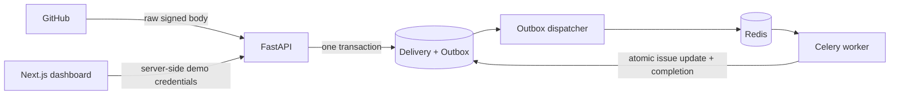

# RepoPilot

A modular monolith for reliable GitHub issue ingestion. Sprint 1 implements the source for
**signed GitHub webhook → PostgreSQL outbox → Celery → issue inbox**. Sprint 2A adds an
initial GitHub App user sign-in and verified personal-account enrollment flow. AI, indexing,
and GitHub writes remain out of scope.

**Status: Sprint 2A implementation is not yet release-verified.** Sprint 1 demo ingestion was verified locally;
the new GitHub authentication/enrollment and bounded sync paths have only been tested with fakes.
The Python lockfile now matches the updated manifest; the new paths still need a locked Docker build and host integration verification.

**Sprint 1 historical status: verified locally.** The host-reported signed webhook
smoke test passed through PostgreSQL, Redis/Celery, the authorized API, and the dashboard data
route; a screenshot showed processed issues in the browser. The PostgreSQL-backed test suite
passed all 39 tests without warnings, and the clean frontend install, type check, lint, tests,
and build passed. Nine frontend tests now include server-rendered loading, error, unauthorized,
empty, and issue-list states; browser fetch transitions and a real GitHub Actions run remain open.
The lockfiles are present but uncommitted. See [verification results](docs/verification.md).

## Quick start

Requirements: Docker Engine/Desktop with Compose v2 supporting `up --wait`, Python 3.12+
(or a recent Python for the small environment helper), Node.js 22 for host frontend checks,
and `uv` 0.13.6 for dependency locking (matching CI and the API image). Internet access is needed for first-time image/dependency downloads.

From this directory:

```bash
# Creates a private, ignored .env with random development-only credentials.
# Refuses to overwrite an existing file. Alternatively copy and edit .env.example.
test -f .env || python3 infra/init_env.py

make dev
make migrate
make seed
make smoke
```

Open **http://localhost:3000**. API docs are at **http://localhost:8000/docs**.
`make seed` creates only the clearly marked demo identity, installation, and repository.
`make smoke` submits a signed demo issue and waits for the real worker to process it.
The dashboard refreshes every five seconds. Seed is repeatable and does not re-enable revoked access.
The smoke test checks unauthenticated reads, invalid signatures, duplicate deliveries, database
issue uniqueness, and the dashboard data route; it does not inspect a rendered browser UI.
A fresh `.env` was generated locally during implementation; do not overwrite it or commit it.

`make dev` builds images, starts PostgreSQL 16 with pgvector, Redis, API, worker, outbox
dispatcher, and web, and waits for health checks. A one-shot migration service runs first.
`make migrate` is useful when adding migrations later. API/web bind to loopback only;
PostgreSQL/Redis do not expose host ports. `make down` preserves database volumes.

```bash
make test                         # Pytest in the API container (SQLite unit/service suite)
cd apps/web && npm ci && npm test && cd ../..
make lint                         # Ruff, frontend type checking, ESLint
make smoke                        # Actual HTTP/database/broker/worker/web-data integration
```

Docker and CI use `uv sync --locked` and `npm ci`. The generated lockfiles are currently
uncommitted; include `apps/api/uv.lock` and `apps/web/package-lock.json` in a future
authorized commit. Run `make lock` only when intentionally updating dependency resolution.

## Review and version control

No files have been staged, committed, or pushed by this hardening task. Review the entire
working tree, including pre-existing changes, before choosing what to include:

```bash
git status --short
git diff
git diff --no-index /dev/null apps/api/uv.lock
git diff --no-index /dev/null apps/web/package-lock.json
```

After reviewing, if you explicitly choose to include all current changes, the following
commands stage the working tree, inspect the staged result, commit locally, and push the
current branch. `git add -A` includes all unignored changes, not just this sprint; inspect
`git status --short` first and stage selected paths instead if any changes should be excluded.
Neither commit nor push has been authorized or performed in this session.

```bash
git add -A
git diff --cached --stat
git diff --cached
git commit -m "Harden Sprint 1 and plan verified GitHub access"
git push -u origin HEAD
```

## Project layout

```text
apps/
  api/
    app/
      api/v1/routes.py          # HTTP validation and tenant-scoped reads
      core/config.py           # Environment validation; production demo prohibition
      domain/models.py         # SQLAlchemy entities and constraints
      modules/
        github/                # Webhook schemas, signature verification, client protocol
        tenancy/               # Development identity and membership check
        ingestion/             # Transactional acceptance and lifecycle revocation
      infra/database.py
      workers/                 # Durable dispatcher and Celery task
      main.py, seed.py, smoke.py
    alembic/versions/0001_foundation.py
    tests/                     # Security, service, retry, isolation, concurrency
    Dockerfile, pyproject.toml
  web/
    app/                       # Next.js App Router and same-origin server routes
    components/                # Inbox dashboard and reusable status badge
    lib/                       # Shared types and server-only API client
    Dockerfile, package.json
docs/
  reference/                   # Preserved architecture proposals; not executable migrations
  adr/0001-foundation.md
  verification.md
infra/init_env.py
.github/workflows/ci.yml
compose.yaml, Makefile, AGENTS.md
```

The original `RepoPilot/` reference bundle and archive remain untouched. The current workspace
is a Git checkout; see the verification record for the status of testing and commits.

## How ingestion works



1. Stream at most 1 MiB; verify HMAC-SHA256 against the original bytes using constant-time
   comparison, following [GitHub's verification guidance](https://docs.github.com/en/webhooks/using-webhooks/validating-webhook-deliveries).
2. Require JSON, a UUID delivery ID, supported event/action, and a valid bounded payload.
3. Check explicit installation/repository authorization. Write the delivery hash and minimal
   normalized outbox payload in one transaction. Never trust a tenant ID from a webhook.
4. Return `202` after commit without contacting GitHub or the broker. Identical redelivery
   returns `200`; reuse of an ID for different content returns `409`.
5. A separate dispatcher polls PostgreSQL using `FOR UPDATE SKIP LOCKED`, publishes the
   stable event ID to Celery, and schedules a retry. The row stays pending until processing
   commits; broker loss after publishing can therefore be repaired by republication.
6. The worker locks the event, installation, and repository, rechecks authorization, updates
   the issue only for a strictly newer GitHub timestamp, and marks completion atomically.

Delivery is **at least once**, with idempotent database effects, not exactly once. A crash
between publish and commit can produce another message. Stable Celery IDs alone do not
deduplicate work; database locks, constraints, and completion state do.

Celery retries transient database failures with bounded exponential backoff and jitter;
see [Celery task semantics](https://docs.celeryq.dev/en/stable/userguide/tasks.html).
The dispatcher makes up to 20 attempts with delays capped at five minutes. After exhaustion,
the event is `failed` and appears in dashboard counts. Inspect service/database health before
an operator resets a failed event to `pending`, `attempts=0`, and `next_dispatch_at=now()`.
Never change the stored payload during replay. Workers still recheck authorization.

Repository locking serializes issue updates within one repository, which is deliberately
simple for Sprint 1. Equal source timestamps keep the first applied state because GitHub
provides no reliable tie-breaker here. A later reconciliation job should resolve this ambiguity.

## API and identity

| Endpoint | Access and behavior |
| --- | --- |
| `GET /health` | Liveness only |
| `GET /ready` | Database schema and Redis reachable; not a worker heartbeat |
| `POST /v1/webhooks/github` | HMAC-authenticated; issues opened/edited and supported installation lifecycle |
| `GET /v1/repositories` | Real session with fresh GitHub repository-access verification, or non-production demo token; max 100 |
| `GET /v1/repositories/{id}/issues?offset=0` | Same tenant and active-installation check; pages of 100, ingestion counts |
| `GET /v1/auth/github/start`, `GET /v1/auth/github/callback` | GitHub App user authorization, browser-bound state and PKCE |
| `GET /v1/auth/me`, `POST /v1/auth/logout` | Session identity; logout requires same-origin CSRF token |
| `GET /v1/installations/available` | GitHub-verified personal-account installations for the signed-in user |
| `POST /v1/installations/{id}/enroll` | CSRF-protected verification and personal-tenant binding |
| `POST /v1/installations/{id}/repositories/{repo}/select` | CSRF-protected public repo selection and durable initial-sync job |
| `GET /v1/installations/sync/{id}` | Tenant- and GitHub-authorized sync status |

Demo authentication requires both a non-production environment and `DEMO_AUTH_ENABLED=true`.
Production rejects this configuration on startup. With demo disabled, data APIs require a valid
GitHub-authenticated session. The demo tenant/user IDs are server configuration,
never client-selected. Unknown and other-tenant repositories both return `404`.

Next.js holds `DEMO_API_TOKEN` server-side. Its shared demo data route is enabled only when
`APP_ENV=development` and the demo switch is true. There is no `NEXT_PUBLIC_` secret.
Anyone who can reach this development dashboard shares its demo identity; keep it on loopback.
Issue titles are rendered as React text, never HTML. No fake issue rows are embedded in the UI.

## Environment

| Variable | Purpose |
| --- | --- |
| `APP_ENV` | `development`, `test`, or `production`; backend default is production |
| `POSTGRES_USER`, `POSTGRES_DB`, `POSTGRES_PASSWORD` | Compose database settings; use generated URL-safe hex password |
| `DATABASE_URL` | SQLAlchemy `postgresql+psycopg://...`; Compose constructs it; required for host API/Alembic |
| `REDIS_URL` | Celery broker/readiness URL; Compose uses `redis://redis:6379/0` |
| `GITHUB_WEBHOOK_SECRET` | At least 32 characters; shared with GitHub App webhook settings |
| `DEMO_AUTH_ENABLED` | Explicit development/test-only backend identity bypass; defaults false |
| `DEMO_API_TOKEN` | At least 32 characters when demo enabled; server-side only |
| `DEMO_USER_ID`, `DEMO_TENANT_ID` | Demo user and tenant membership IDs; default 1 |
| `API_INTERNAL_URL` | Next.js server-to-API URL; Compose uses `http://api:8000` |
| `TEST_DATABASE_URL` | Disposable PostgreSQL database for concurrency tests; test suite drops its tables |
| `SMOKE_API_URL`, `SMOKE_WEB_URL` | Optional smoke overrides; defaults to Compose service names |
| `GITHUB_OAUTH_ENABLED` | Explicit opt-in for real GitHub sign-in; defaults false |
| `GITHUB_APP_ID`, `GITHUB_CLIENT_ID`, `GITHUB_CLIENT_SECRET` | GitHub App ID and OAuth client credentials |
| `GITHUB_TOKEN_ENCRYPTION_KEY` | Fernet key used to encrypt GitHub tokens and one-time PKCE verifiers |
| `GITHUB_CALLBACK_URL`, `WEB_ORIGIN` | Fixed browser origin and `/api/auth/callback`; HTTPS is required in production |

Never log `.env`, Authorization headers, tokens, or webhook bodies. Application logs use fixed
JSON event names; SQLAlchemy hides parameters from errors. PostgreSQL holds issue descriptions
and normalized outbox data, so database access and backups also need protection.

## GitHub App setup (Sprint 2A)

This implementation is **not yet release-verified**. Automated tests use an injected GitHub
client; no real GitHub login, app installation, PostgreSQL upgrade, or production deployment
has been validated in this workspace. No credentials are required for the Sprint 1 demo.

1. On a disposable, authorized personal test account, create a GitHub App with **Issues: read**
   and automatic **Metadata: read**; do not grant write permissions. Subscribe to issues and
   installation/installation-repositories lifecycle events. Install on selected **public** repos.
2. Configure an exact GitHub App user-authorization callback matching
   `http://localhost:3000/api/auth/callback` for local development, or an HTTPS origin with the
   same callback path in production. A public HTTPS webhook URL must route to
   `/v1/webhooks/github`; GitHub cannot reach localhost without an explicitly configured ingress.
3. In the ignored `.env`, set `GITHUB_OAUTH_ENABLED=true`, `GITHUB_APP_ID`, `GITHUB_CLIENT_ID`,
   `GITHUB_CLIENT_SECRET`, `GITHUB_CALLBACK_URL`, `WEB_ORIGIN`, and a fresh Fernet key in
   `GITHUB_TOKEN_ENCRYPTION_KEY`. Generate the key locally with Python's
   `cryptography.fernet.Fernet.generate_key()`; never paste secrets into logs, commits or chat.
   Keep `DEMO_AUTH_ENABLED=false` for real-user testing. Configure all five app processes through
   Compose; do not expose the Redis/PostgreSQL ports or demo UI publicly.
4. With the updated lockfile, run `make dev`, `make migrate` and `make smoke`; the migration
   service upgrades existing data.
   Back up and test on a disposable database before applying the migration to real data.
5. Choose **Sign in with GitHub**, authorize the App, and use **Find installations**. Only
   installations belonging to the signed-in user's personal account and public repositories
   accessible to the user token are eligible. Organization enrollment is not yet implemented.
   Explicitly verify an installation and connect a repository; this queues a durable bounded sync.
6. Removal, suspension and accepted permission changes fail closed; repository removal disables
   it. Tombstones prevent late enrollment/selection from undoing a prior removal. Re-enabling a
   revoked installation or repository is intentionally unavailable until reviewed reconciliation
   and reauthorization are implemented. GitHub additions and unsuspension never auto-enable access.

GitHub user access tokens remain encrypted on the server, not in browser JavaScript. Sessions
expire after at most one hour and require a fresh login; refresh tokens are not persisted. Initial
sync reads at most the first 100 GitHub issue/PR entries and explicitly reports `partial` when the
limit is reached. It does not claim complete history, pagination, or close/delete reconciliation.
A reverse proxy must redact authorization callback query strings, and the Docker API disables
Uvicorn access logging to avoid logging authorization codes. Add production rate limiting,
credential retention cleanup and independent security review before serving external users.

## Testing and CI

Backend tests cover signatures, malformed input, headers, size limits, unsupported actions,
deduplication, rollback, retry, worker idempotency, stale/equal timestamps, revocation, and
cross-tenant access. The signed HTTP-to-worker-to-read test uses an injected database factory.
CI configures PostgreSQL for the row-lock concurrency test and exercises migration upgrade,
metadata drift detection, downgrade, and upgrade. Never point `TEST_DATABASE_URL` at real data.

A separate Compose smoke job tests actual PostgreSQL/Redis/Celery and the Next.js data route.
The frontend job checks strict TypeScript, ESLint, mocked API-route tests, and a production build. These workflows
are authored but have not run on GitHub from this workspace.

For an offline signature-only check with Pytest available:

```bash
PYTHONPATH=apps/api python -m pytest --confcutdir=apps/api/tests/unit apps/api/tests/unit -q
```

For host development, install via `uv sync --locked` in `apps/api` and `npm ci` in `apps/web`,
provide reachable database/Redis URLs, run `uv run alembic upgrade head`, and start API,
dispatcher, Celery, and Next.js independently using the commands from Compose.

## Current limitations and next tasks

- Lockfiles are uncommitted; GitHub Actions and browser fetch transitions have not been verified.
- ESLint 9 is end-of-life; locked peer dependencies need a compatible, tested upgrade to ESLint 10.
- GitHub OAuth and personal-account enrollment are implemented but not tested with real credentials,
  PostgreSQL migrations, or concurrent revocation in PostgreSQL. Organization enrollment,
  reauthorization, RLS, token cleanup, retention/deletion automation, lifecycle reconciliation,
  and visibility/transfer reconciliation remain incomplete. Tenant isolation currently relies on
  query scopes, GitHub access rechecks, and composite database foreign keys.
- The updated Python lock matches the manifest, but the new locked Docker build and CI have not run.
- Only issue opened/edited events are supported; close/reopen/delete synchronization is deferred.
- No AI, repository indexing, shell execution, GitHub writes, or private-repository ingestion.
- The dashboard repository picker is capped at 100. Issue pagination is offset-based.
- Readiness does not prove worker health; the smoke test checks the original webhook processing path end to end.
- No deployment, HA guarantee, backup/restore drill, or browser-rendered E2E test has been performed.

Next three engineering tasks:
1. Verify clean installs, PostgreSQL, Docker build, and live smoke on an unrestricted host; commit the existing lockfiles with authorization.
2. Verify GitHub auth, secure sessions, enrollment, and sync on a disposable host with real test credentials.
3. Add lifecycle reconciliation, failed-event recovery tooling, retention, and worker health metrics before starting indexing.

The [Sprint 2 plan](docs/SPRINT_2_PLAN.md) describes the wider milestone; the 2A implementation is a restricted, unverified first increment and does not add AI features.
