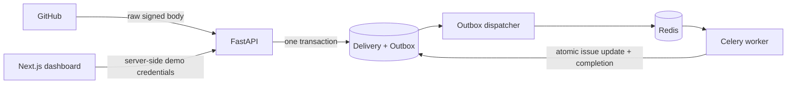

# RepoPilot

A modular monolith for reliable GitHub issue ingestion. Sprint 1 implements the source for
**signed GitHub webhook → PostgreSQL outbox → Celery → issue inbox**. AI, indexing, OAuth,
and GitHub writes are intentionally outside this sprint.

**Status: implementation present, acceptance verification incomplete.** This workspace could
not download dependencies or access Docker. Dependency lockfiles have **not** been generated;
full tests, migrations, and the live smoke test have **not** passed here. See
[verification results](docs/verification.md). Do not treat this as a production-ready release.

## Quick start

Requirements: Docker Engine/Desktop with Compose v2 supporting `up --wait`, Python 3.12+
(or a recent Python for the small environment helper), Node.js 22 for host frontend checks,
and `uv` 0.9.5 for dependency locking (matching CI and the API image). Internet access is needed for first-time image/dependency downloads.

From this directory:

```bash
# Creates a private, ignored .env with random development-only credentials.
# Refuses to overwrite an existing file. Alternatively copy and edit .env.example.
test -f .env || python3 infra/init_env.py

# Required first-time task until resolved lockfiles are committed.
make lock

make dev
make migrate
make seed
make smoke
```

Open **http://localhost:3000**. API docs are at **http://localhost:8000/docs**.
`make seed` creates only the clearly marked demo identity, installation, and repository.
`make smoke` submits a signed demo issue and waits for the real worker to process it.
The dashboard refreshes every five seconds. Seed is repeatable and does not re-enable revoked access.
The smoke test checks unauthenticated reads, invalid signatures, duplicate deliveries, database
issue uniqueness, and the dashboard data route; it does not inspect a rendered browser UI.
A fresh `.env` was generated locally during implementation; do not overwrite it or commit it.

`make dev` builds images, starts PostgreSQL 16 with pgvector, Redis, API, worker, outbox
dispatcher, and web, and waits for health checks. A one-shot migration service runs first.
`make migrate` is useful when adding migrations later. API/web bind to loopback only;
PostgreSQL/Redis do not expose host ports. `make down` preserves database volumes.

```bash
make test                         # Pytest in the API container (SQLite unit/service suite)
cd apps/web && npm ci && cd ../..
make lint                         # Ruff, frontend type checking, ESLint
make smoke                        # Actual HTTP/database/broker/worker/web-data integration
```

Docker and CI require committed lockfiles (`uv sync --locked` / `npm ci`) and intentionally
fail without them. After `make lock`, commit `apps/api/uv.lock` and
`apps/web/package-lock.json`. This is an explicit unfinished reproducibility gate;
no fabricated or partially resolved lockfiles are included.

## Project layout

```text
apps/
  api/
    app/
      api/v1/routes.py          # HTTP validation and tenant-scoped reads
      core/config.py           # Environment validation; production demo prohibition
      domain/models.py         # SQLAlchemy entities and constraints
      modules/
        github/                # Webhook schemas, signature verification, client protocol
        tenancy/               # Development identity and membership check
        ingestion/             # Transactional acceptance and lifecycle revocation
      infra/database.py
      workers/                 # Durable dispatcher and Celery task
      main.py, seed.py, smoke.py
    alembic/versions/0001_foundation.py
    tests/                     # Security, service, retry, isolation, concurrency
    Dockerfile, pyproject.toml
  web/
    app/                       # Next.js App Router and same-origin server routes
    components/                # Inbox dashboard and reusable status badge
    lib/                       # Shared types and server-only API client
    Dockerfile, package.json
docs/
  reference/                   # Preserved architecture proposals; not executable migrations
  adr/0001-foundation.md
  verification.md
infra/init_env.py
.github/workflows/ci.yml
compose.yaml, Makefile, AGENTS.md
```

The original `RepoPilot/` reference bundle and archive remain untouched. This workspace
was not a Git checkout; no commits, pushes, or deployment were performed.

## How ingestion works



1. Stream at most 1 MiB; verify HMAC-SHA256 against the original bytes using constant-time
   comparison, following [GitHub's verification guidance](https://docs.github.com/en/webhooks/using-webhooks/validating-webhook-deliveries).
2. Require JSON, a UUID delivery ID, supported event/action, and a valid bounded payload.
3. Check explicit installation/repository authorization. Write the delivery hash and minimal
   normalized outbox payload in one transaction. Never trust a tenant ID from a webhook.
4. Return `202` after commit without contacting GitHub or the broker. Identical redelivery
   returns `200`; reuse of an ID for different content returns `409`.
5. A separate dispatcher polls PostgreSQL using `FOR UPDATE SKIP LOCKED`, publishes the
   stable event ID to Celery, and schedules a retry. The row stays pending until processing
   commits; broker loss after publishing can therefore be repaired by republication.
6. The worker locks the event, installation, and repository, rechecks authorization, updates
   the issue only for a strictly newer GitHub timestamp, and marks completion atomically.

Delivery is **at least once**, with idempotent database effects, not exactly once. A crash
between publish and commit can produce another message. Stable Celery IDs alone do not
deduplicate work; database locks, constraints, and completion state do.

Celery retries transient database failures with bounded exponential backoff and jitter;
see [Celery task semantics](https://docs.celeryq.dev/en/stable/userguide/tasks.html).
The dispatcher makes up to 20 attempts with delays capped at five minutes. After exhaustion,
the event is `failed` and appears in dashboard counts. Inspect service/database health before
an operator resets a failed event to `pending`, `attempts=0`, and `next_dispatch_at=now()`.
Never change the stored payload during replay. Workers still recheck authorization.

Repository locking serializes issue updates within one repository, which is deliberately
simple for Sprint 1. Equal source timestamps keep the first applied state because GitHub
provides no reliable tie-breaker here. A later reconciliation job should resolve this ambiguity.

## API and identity

| Endpoint | Access and behavior |
| --- | --- |
| `GET /health` | Liveness only |
| `GET /ready` | Database schema and Redis reachable; not a worker heartbeat |
| `POST /v1/webhooks/github` | HMAC-authenticated; issues opened/edited and supported installation lifecycle |
| `GET /v1/repositories` | Bearer demo token + database membership; enabled tenant repositories only, max 100 |
| `GET /v1/repositories/{id}/issues?offset=0` | Same tenant and active-installation check; pages of 100, ingestion counts |

Demo authentication requires both a non-production environment and `DEMO_AUTH_ENABLED=true`.
Production rejects this configuration on startup. With demo disabled, data APIs fail closed
until real authentication is implemented. The demo tenant/user IDs are server configuration,
never client-selected. Unknown and other-tenant repositories both return `404`.

Next.js holds `DEMO_API_TOKEN` server-side. Its shared demo data route is enabled only when
`APP_ENV=development` and the demo switch is true. There is no `NEXT_PUBLIC_` secret.
Anyone who can reach this development dashboard shares its demo identity; keep it on loopback.
Issue titles are rendered as React text, never HTML. No fake issue rows are embedded in the UI.

## Environment

| Variable | Purpose |
| --- | --- |
| `APP_ENV` | `development`, `test`, or `production`; backend default is production |
| `POSTGRES_USER`, `POSTGRES_DB`, `POSTGRES_PASSWORD` | Compose database settings; use generated URL-safe hex password |
| `DATABASE_URL` | SQLAlchemy `postgresql+psycopg://...`; Compose constructs it; required for host API/Alembic |
| `REDIS_URL` | Celery broker/readiness URL; Compose uses `redis://redis:6379/0` |
| `GITHUB_WEBHOOK_SECRET` | At least 32 characters; shared with GitHub App webhook settings |
| `DEMO_AUTH_ENABLED` | Explicit development/test-only backend identity bypass; defaults false |
| `DEMO_API_TOKEN` | At least 32 characters when demo enabled; server-side only |
| `DEMO_USER_ID`, `DEMO_TENANT_ID` | Demo user and tenant membership IDs; default 1 |
| `API_INTERNAL_URL` | Next.js server-to-API URL; Compose uses `http://api:8000` |
| `TEST_DATABASE_URL` | Disposable PostgreSQL database for concurrency tests; test suite drops its tables |
| `SMOKE_API_URL`, `SMOKE_WEB_URL` | Optional smoke overrides; defaults to Compose service names |

Never log `.env`, Authorization headers, tokens, or webhook bodies. Application logs use fixed
JSON event names; SQLAlchemy hides parameters from errors. PostgreSQL holds issue descriptions
and normalized outbox data, so database access and backups also need protection.

## GitHub App setup

No GitHub credentials are necessary for local smoke tests. For a later real development trial:

1. Register a dedicated GitHub App on a test account. Request **Issues: read** and the automatic
   **Metadata: read** permission. Sprint 1 does not need Contents or any write permission.
2. Set its webhook URL to your HTTPS ingress ending in `/v1/webhooks/github`, and set the secret
   to match your private environment value. Subscribe to issues and installation/repository
   selection lifecycle events. GitHub will not reach a localhost-only URL.
3. Install on selected public repositories only. Verify installation/repository IDs and ownership
   through GitHub before enrolling them.
4. **Enrollment is intentionally disabled in this sprint.** `installation.created`, additions,
   and unsuspension never authorize or re-enable anything. The only built-in authorized fixture
   is installation `1001`, repository `2001`, `demo/repopilot-sandbox`. Do not substitute a real
   repository into the shared demo without a reviewed enrollment/authentication flow.
5. Deletion/suspension immediately disables the installation. Repository removal disables that
   repository. Both block reads and cause queued work to be ignored. Re-authorization is an
   explicit future operator workflow; stale lifecycle messages cannot silently re-enable access.

There are **no outbound GitHub API calls** in Sprint 1. The `GitHubClient` protocol is the
injection boundary for future services; no credentials or fake successful network client exist.

## Testing and CI

Backend tests cover signatures, malformed input, headers, size limits, unsupported actions,
deduplication, rollback, retry, worker idempotency, stale/equal timestamps, revocation, and
cross-tenant access. The signed HTTP-to-worker-to-read test uses an injected database factory.
CI configures PostgreSQL for the row-lock concurrency test and exercises migration upgrade,
metadata drift detection, downgrade, and upgrade. Never point `TEST_DATABASE_URL` at real data.

A separate Compose smoke job tests actual PostgreSQL/Redis/Celery and the Next.js data route.
The frontend job checks strict TypeScript, ESLint, and a production build. These workflows
are authored but have not run on GitHub from this workspace.

For an offline signature-only check with Pytest available:

```bash
PYTHONPATH=apps/api python -m pytest --confcutdir=apps/api/tests/unit apps/api/tests/unit -q
```

For host development, install via `uv sync --locked` in `apps/api` and `npm ci` in `apps/web`,
provide reachable database/Redis URLs, run `uv run alembic upgrade head`, and start API,
dispatcher, Celery, and Next.js independently using the commands from Compose.

## Current limitations and next tasks

- Missing dependency locks and unexecuted runtime/build verification are release blockers.
- OAuth, sessions, real installation enrollment, RLS, retention/deletion automation, lifecycle
  reconciliation, and repository visibility/transfer reconciliation are deferred. Tenant isolation
  currently relies on query scopes plus composite database foreign keys.
- Only issue opened/edited events are supported; close/reopen/delete synchronization is deferred.
- No AI, repository indexing, shell execution, GitHub writes, or private-repository ingestion.
- The dashboard repository picker is capped at 100. Issue pagination is offset-based.
- Readiness does not prove worker health; the smoke test checks processing end to end.
- No deployment, HA guarantee, backup/restore drill, or browser-rendered E2E test has been performed.

Next three engineering tasks:
1. Resolve and commit lockfiles, run/fix PostgreSQL CI, build, and live smoke on a Docker-capable host.
2. Implement GitHub user authentication, secure sessions, and verified tenant/installation enrollment.
3. Add lifecycle reconciliation, failed-event recovery tooling, retention, and worker health metrics before starting indexing.
